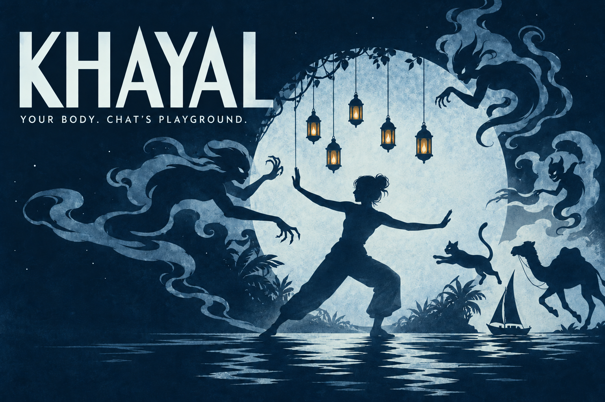

# Khayal · خيال

**Your body. Chat’s playground.** A local shadowplay where Twitch chat controls the company and the streamer’s silhouette guards five lanterns.



**Status: development preview, not yet submission-ready.** Thirty automated tests and the production build pass. Browser, real-camera, real-Twitch, human fairness and OBS acceptance are still pending. The cover is a promotional illustration, not gameplay footage. [Current gates](docs/hackathon-build/checklist.md) · [Submission studio](submission/README.md)

## Run locally

Requires Node 22.12+ and current desktop Chrome.

```sh
npm ci
npm run dev
```

Open http://localhost:5173/ and **Enter the theatre**, then **Director’s desk**. Bundled fonts and vision assets are local. To re-fetch pinned upstream camera assets, run `npm run assets:vision`. Production: `npm run build`, then `npm start`. Both servers use localhost:5173 with a strict port, so only one can run at a time.

## Play

From the director’s desk, start the rehearsal company or send `!cat`, `!camel`, `!goha`, `!boat`, `!croc`. Move with `!left`, `!right`, `!jump`; change projected depth with `!closer`/`!far`; add a 60-grapheme plain-text caption with `!say hello`. One puppet per viewer, 24 on stage and a bounded fair queue.

**Afreet Hunt:** 60 seconds after a 3-second countdown. Chat sends `!afreet` and dodges with `!up`/`!down`; the performer keeps at least three of five lights burning. Camera motion is measured at the silhouette boundary; moving a hand wholly inside an unchanged torso outline does not create a swat. Ordinary puppets also bounce on a fresh outline hit.

Mods use `!khayal pause`, `!khayal clear`, `!khayal ban @login`. Stage blocks never ban a Twitch account. Captions are plain text, links/controls removed, and moderated deletions are synchronized. Source labels distinguish simulator and live mode; switching source clears rehearsal state.

Keys 1 / 2 / 4 opens theatre/starts Hunt/exports cast; Space pauses. Escape leaves focus mode. **Save frame** exports the actual canvas. **Record stage** exports up to 3 minutes of video-only canvas capture; add the owner voice in the edit. Multiple playbill pages preserve large casts. **Sound** enables original quiet synthesized cues; it starts off and contains no sampled music or crowd voice.

## Connect Twitch

Register a dedicated **Khayal Theatre** application: Game Integration, Confidential for the implicit flow, redirect **http://localhost:5173/**. Copy `.env.example` to `.env.local`, set the public `VITE_TWITCH_CLIENT_ID`, and restart the server. Every frontend environment value is public: never add a client secret. Connect your own broadcaster account while the show is stopped. Scopes: `user:read:chat moderator:read:followers`.

Tokens remain in memory, OAuthstate is verified, validation repeats hourly, and reload/expiry requires reauthorization. EventSub handles chat/moderation/follow/raid, deduplicates notifications, and distinguishes reconnect handover from fresh subscription setup. The dedicated app is not yet created because browser control in the current development session is unavailable. No code test substitutes for real event qualification.

## Camera, capture and privacy

Enable silhouette and grant video permission in the stage window. No microphone is requested. The model/WASM are served locally, with one frame in flight and no camera-upload endpoint. Choose GPU/CPU and 15/30 inference fps in the director’s settings. Stale or failed inference hides the shadow and pauses a Hunt. Keep the stage visible; use OBS Virtual Camera if another app already owns the camera.

For full live capture use OBS window capture at 1920×1080, with cue book excluded. Actual camera latency, swat accuracy, sustained rendering during OBS recording and human fairness remain unmeasured. The source-levelfps counter is not a verified benchmark.

## Submission and reproducibility

```sh
npm test
npm run build
npm run submission:frames
npm run submission:captions
npm run submission:review
npm run submission:check
```

Frame exports use the same original SVGspecies paths and scene layout as Pixi, with synthetic Director fixtures; they are labeled engine rehearsal previews, not browser screenshots or realcamera/Twitch evidence. The2:30captioned review video uses those previews, promotional illustration and editorial source cards. It has no ownervoice and is not the final demo. The final edit script reports missing genuine captures and voice rather than inventing them. `submission/voiceover-script.md` contains eight recording takes.

The cyanotype art direction deliberately differs from Aragoz’s wood/brass/curtainworkshop. Khayal’s distinguishing mechanic is body-driven shadow defense; changing colors alone would not establish a substantially different contest entry. Prior winners and inspirations are credited in `submission/research.md`.

## Licenses

Application code and original procedural vector artwork: MIT. Local font families: SIL OFL notices and upstreammanifest in `public/assets/fonts/`. MediaPipe runtime/selfie model: upstreamGoogle/MediaPipe distribution, Apache 2.0 notice in `public/assets/vision/`; sourceURLs and hashes in its manifest. Promotional cover: generated with the owner’s authorization through OpenAI image generation; exactprompt, provenance and source category are beside the PNG. It is included as project promotional media, not a claim of human photography or live performance. No Aragoz artwork or code was copied.

Do not publish participant recordings or names without their permission. No completed Devpost submission, owner attestation or award is claimed.
