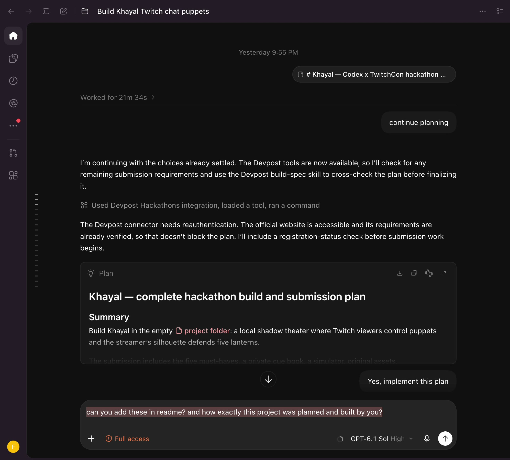
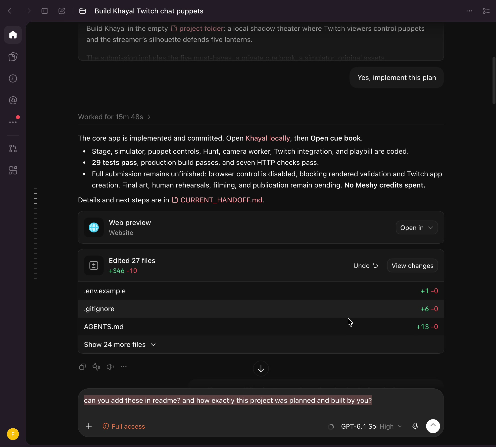

# Khayal · خيال

**Your body. Chat’s playground.** A local shadowplay where Twitch chat controls the company and the streamer’s silhouette guards five lanterns.


**Status: development preview, not yet submission-ready.** Thirty automated tests and the production build pass. The first actual browser/camera/Twitch broadcaster test is recorded. Multi-viewer fairness, formal swat accuracy, real follow/raid and OBS acceptance remain pending. The cover is a promotional illustration, not gameplay footage. [Current gates](docs/hackathon-build/checklist.md) · [Submission studio](submission/README.md)

[Watch the public gameplay demo](https://www.youtube.com/watch?v=vynF1sjtyFw) · [Devpost project draft](https://devpost.com/software/khayal)

## Planned and built with Codex

Amir supplied the hackathon brief, approved the implementation plan, directed the visual redesign, provided the narration and recorded the Codex conversation below. Codex served as the implementation agent: it turned the brief into a technical plan, wrote the application and tests, revised the design, operated authorized browser tests, and prepared the submission media. This was an iterative collaboration with specific decisions and corrections from Amir.

1. **Define the performance and its limits.** The accepted plan fixed the five-lantern Hunt, viewer-owned puppets, a fair queue, a private cue book and a simulator. Optional modes were deferred. Local processing, memory-only tokens and honest separation of rehearsal from Twitch evidence were explicit constraints.
2. **Choose one source of truth.** Codex built a Vite/TypeScript app in which one stage owns show state, rendering, Twitch and the camera. A separate cue-book window exchanges typed actions and status through `BroadcastChannel`. A Web Lock prevents a second stage owner.
3. **Implement the interaction rules first.** Live and simulated messages enter the same command parser and Director. Viewer ownership, moderation, cooldowns, queue rotation, Hunt timing and scoring are tested independently of rendering.
4. **Connect camera and Twitch.** Codex implemented the MediaPipe worker, shared mask/collision transforms, outline-motion detector, OAuth validation and EventSub lifecycle. Amir approved account authorization and camera permission. Authorized broadcaster chat tests then exercised real puppet commands and a recorded Hunt hit.
5. **Redesign and refine.** Amir rejected the earlier visual similarity to Aragoz. Codex rebuilt Khayal around a moonlit cyanotype stage and original vector figures. Browser tests exposed Arabic joining and cue-window issues, which were fixed. No Meshy or Blender asset production is claimed.
6. **Verify and prepare the entry.** Codex ran tests/builds, recorded validation receipts, aligned the supplied narration, repaired missing audio/caption delivery, packaged actual captures, and published the authorized demo. Human performance and final submission gates remain open.

The [detailed build account](docs/BUILD_WITH_CODEX.md) maps these decisions to source files, commits and verification records.

### Actual Codex conversation

These stills were extracted from Amir's supplied screen recording. Crops isolate the conversation pane; the text and UI have not been reconstructed or generated.



*Planning evidence: the existing Codex thread shows the plan and the instruction to implement it.*



*Implementation evidence: an earlier checkpoint and its changed-file summary. The visible 29-test result and browser blocker describe that historical point; the current suite has 30 tests and later browser/Twitch checks are recorded separately.*

[Watch or download the 19-second owner-supplied Codex walkthrough](docs/media/codex/owner-build-walkthrough.mp4). It scrolls through existing conversation records; it is not a continuous recording of code being written or proof that every acceptance gate passed. [Media provenance](docs/media/codex/provenance.json).

## Run locally

Requires Node 22.12+ and current desktop Chrome.

```sh
npm ci
npm run dev
```

Open http://localhost:5173/ and **Enter the theatre**, then **Director’s desk**. Bundled fonts and vision assets are local. To re-fetch pinned upstream camera assets, run `npm run assets:vision`. Production: `npm run build`, then `npm start`. Both servers use localhost:5173 with a strict port, so only one can run at a time.

## Play

From the director’s desk, start the rehearsal company or send `!cat`, `!camel`, `!goha`, `!boat`, `!croc`. Move with `!left`, `!right`, `!jump`; change projected depth with `!closer`/`!far`; add a 60-grapheme plain-text caption with `!say hello`. One puppet per viewer, 24 on stage and a bounded fair queue.

**Afreet Hunt:** 60 seconds after a 3-second countdown. Chat sends `!afreet` and dodges with `!up`/`!down`; the performer keeps at least three of five lights burning. Camera motion is measured at the silhouette boundary; moving a hand wholly inside an unchanged torso outline does not create a swat. Ordinary puppets also bounce on a fresh outline hit.

Mods use `!khayal pause`, `!khayal clear`, `!khayal ban @login`. Stage blocks never ban a Twitch account. Captions are plain text, links/controls removed, and moderated deletions are synchronized. Source labels distinguish simulator and live mode; switching source clears rehearsal state.

Keys 1 / 2 / 4 opens theatre/starts Hunt/exports cast; Space pauses. Escape leaves focus mode. **Save frame** exports the actual canvas. **Record stage** exports up to 3 minutes of video-only canvas capture; add the owner voice in the edit. Multiple playbill pages preserve large casts. **Sound** enables original quiet synthesized cues; it starts off and contains no sampled music or crowd voice.

## Connect Twitch

Register a dedicated **Khayal Theatre** application: Game Integration, Confidential for the implicit flow, redirect **http://localhost:5173/**. Copy `.env.example` to `.env.local`, set the public `VITE_TWITCH_CLIENT_ID`, and restart the server. Every frontend environment value is public: never add a client secret. Connect your own broadcaster account while the show is stopped. Scopes: `user:read:chat moderator:read:followers`.

Tokens remain in memory, OAuth state is verified, validation repeats hourly, and reload/expiry requires reauthorization. EventSub handles chat/moderation/follow/raid, deduplicates notifications, and distinguishes reconnect handover from fresh subscription setup. The dedicated Khayal Theatre app was created and an authorized broadcaster chat/camera test was recorded. Reloading the stage still requires a new login; real follow/raid and multi-viewer qualification remain pending. [Browser test record](docs/browser-live-validation.json).

## Camera, capture and privacy

Enable silhouette and grant video permission in the stage window. No microphone is requested. The model/WASM are served locally, with one frame in flight and no camera-upload endpoint. Choose GPU/CPU and 15/30 inference fps in the director’s settings. Stale or failed inference hides the shadow and pauses a Hunt. Keep the stage visible; use OBS Virtual Camera if another app already owns the camera.

For full live capture use OBS window capture at 1920×1080, with cue book excluded. Actual camera latency, swat accuracy, sustained rendering during OBS recording and human fairness remain unmeasured. The source-levelfps counter is not a verified benchmark.

## Submission and reproducibility

```sh
npm test
npm run build
npm run submission:frames
npm run submission:captions
npm run submission:review
npm run submission:check
```

Frame exports use the same original SVGspecies paths and scene layout as Pixi, with synthetic Director fixtures; they are labeled engine rehearsal previews, not browser screenshots or realcamera/Twitch evidence. The current 1:54 review contains actual Twitch/camera footage, a labeled animated rehearsal and actual cue-book/playbill captures. Its 56 captions use validated DTW token timing and explicit30fps image frames; its complete narration uses an independently encoded continuous PCM bed. Eight decoded speech windows and112 caption frames pass technical checks. Full listening review remains open. The older narrated still-image cut is retired after sync defects. `submission/voiceover-script.md` contains eight recording takes.

The cyanotype art direction deliberately differs from Aragoz’s wood/brass/curtainworkshop. Khayal’s distinguishing mechanic is body-driven shadow defense; changing colors alone would not establish a substantially different contest entry. Prior winners and inspirations are credited in `submission/research.md`.

## Licenses

Application code and original procedural vector artwork: MIT. Local font families: SIL OFL notices and upstreammanifest in `public/assets/fonts/`. MediaPipe runtime/selfie model: upstreamGoogle/MediaPipe distribution, Apache 2.0 notice in `public/assets/vision/`; sourceURLs and hashes in its manifest. Promotional cover: generated with the owner’s authorization through OpenAI image generation; exactprompt, provenance and source category are beside the PNG. It is included as project promotional media, not a claim of human photography or live performance. No Aragoz artwork or code was copied.

Do not publish participant recordings or names without their permission. No completed Devpost submission, owner attestation or award is claimed.
