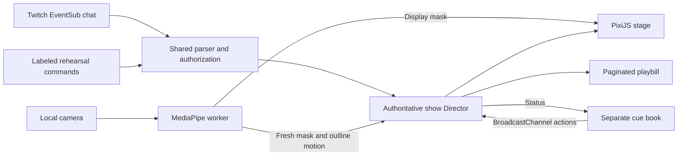

# How Khayal was planned and built

Khayal was developed through the Codex conversation identified by session `01a17eb7-e4d9-7453-9053-6b3eab7a4153`. Amir supplied the brief and directed the project; Codex translated those instructions into architecture, implementation, verification and submission artifacts. The owner-supplied [screen recording](media/codex/owner-build-walkthrough.mp4) shows the actual conversation's planning and implementation records. It supplements the source and commit history rather than documenting every development action on video.

## From brief to a bounded plan

The starting brief proposed Egyptian shadow theatre as a shared Twitch performance: chat takes the puppets and the streamer's camera silhouette defends lanterns. The accepted plan made this concrete: five one-hit lanterns, a 60-second Hunt, one puppet per viewer, 24 active actors, a bounded FIFO queue, moderated captions, follow/raid ceremonies and a cast playbill. It also defined the simulator, cue book, privacy constraints, delivery milestones and acceptance checks. See the [accepted specification](hackathon-build/spec.md) and [current checklist](hackathon-build/checklist.md).

The plan separated implementation from evidence. Unit tests could establish command and timing rules; they could not establish human swat accuracy, real Twitch event delivery or OBS performance. This distinction remains in the current status instead of treating an implemented feature as a completed rehearsal.

## Architecture and implementation

Codex selected and configured pinned Vite, TypeScript, PixiJS, MediaPipe Tasks Vision and Vitest dependencies. The application runs locally without a backend. One stage owns the authoritative Director, Twitch connection and camera. The cue book is a separate window, with per-show messaging and a heartbeat; a browser Web Lock prevents duplicate stage ownership.

| Work | Implementation and reason |
|---|---|
| Commands and safety | [`commands.ts`](../src/twitch/commands.ts) parses commands, sanitizes captions and applies cooldowns. [`director.ts`](../src/show/director.ts) owns viewer participation, queues and round rules, keeping those rules testable without a renderer. |
| Twitch | [`client.ts`](../src/twitch/client.ts) implements OAuth validation, broadcaster binding, EventSub subscriptions, deduplication, reconnects and moderation events. Tokens remain in browser memory. |
| Camera | [`segmenter.worker.ts`](../src/vision/segmenter.worker.ts), [`controller.ts`](../src/vision/controller.ts) and [`masks.ts`](../src/vision/masks.ts) implement local inference, one frame in flight, crop/mirror alignment, mask freshness and temporal boundary motion. A still overlap is insufficient for a hit. |
| Windows and rendering | [`main.ts`](../src/main.ts) coordinates stage/cue ownership and actions. [`render.ts`](../src/stage/render.ts) draws the show using shared scene/vector assets. |
| Credits | [`export.ts`](../src/playbill/export.ts) exports additional playbill pages when needed so names are not silently omitted. |

## Design iteration

Amir explicitly rejected the initial resemblance to the separate Aragoz project. The replacement [design direction](DESIGN_DIRECTION.md) uses open midnight-blue space, pale cut-paper silhouettes, an abstract moon/water setting and amber flames. Codex authored shared vector species and scene geometry for the runtime and labeled rehearsal exports. Aragoz code and artwork were not copied.

The original Meshy/Blender asset-production route was not carried out; no credits were spent and no Blender production footage is claimed. The cover was produced through authorized image generation and is labeled promotional illustration. Its [provenance](../submission/artwork/khayal-devpost-3x2.provenance.json) is separate from gameplay evidence.

## Testing, corrections and actual interaction

Codex wrote tests for command ownership, moderator authority, Unicode captions, cooldowns, queue fairness, camera-motion rules, Hunt timing and Twitch lifecycle handling. The current suite contains 64 tests in seven files. A fresh public clone at runtime revision `f116d90` passes npmci, all64tests, the production build and8asset hashes. Its [release receipt](clean-release-validation.json) also records actual clean browser startup and a51-name two-page playbill without private configuration.

Once browser access worked, Codex created the dedicated Twitch app and exercised authorized broadcaster commands. Amir approved OAuth and camera access. Actual chat/camera recordings show puppet control and one detected Hunt hit with five lanterns retained. This was a broadcaster test in an offline channel, not a multi-viewer live broadcast. Browser testing also exposed and led to fixes for Arabic joining and separate cue-window opening/recovery. See [browser validation](browser-live-validation.json).

Amir then identified that the first review video lacked gameplay and had subtitle-sync problems. Codex replaced the still-image cut with actual recordings and audited the final encoded media. The repair uses a continuous PCM narration bed, independently encoded AAC and explicit caption frames. [Technical video checks](gameplay-demo-validation.json) cover audio continuity, eight voice-timing windows and 112 caption-frame samples; they do not claim a full human listening review.

Browser-led hardening added bounded camera startup/reconfiguration, duplicate-callback URL scrubbing, ceremony suspension during Hunt, queued-caption moderation and visible-time queue rotation. Playbill pages now have explicit download links and wrap long Arabic names without dropping characters. A five-minute real-camera/local GPU observation kept 24 simulated puppets throughout and met the numeric targets; [its receipt](performance-browser-validation.json) explicitly excludes OBS and human qualification.

## Delivery and responsibility

Codex prepared the repository, setup instructions, promotional cover, actual-capture gallery, story, captions and video. Amir supplied the narration and this Codex screen recording and authorized publication. The [public demo](https://www.youtube.com/watch?v=VxjgW2sga6o) and [publication receipt](youtube-revised-publication-validation.json) record that delivery. The revised public demo now includes the owner-supplied Codex recording in its build section. Historical planning/checkpoint text remains labeled as historical.

| Amir | Codex |
|---|---|
| Brief, scope approvals, design direction, feedback, supplied media, personal permissions and declarations | Technical planning, application/art implementation, automated checks, authorized browser operations, media processing, documentation and submission preparation |

The Devpost entry remains a draft. Human fairness, formal swat/static-overlap testing, real follow/raid qualification, sustained OBS measurements and full listening review remain open. Eligibility declarations remain unchecked at Amir's instruction. Neither the screenshots nor a passing build establish those separate gates.

## Source checkpoints

| Commit | Recorded milestone |
|---|---|
| [`7ecc276`](https://github.com/AmirmLotfy/Khayal/commit/7ecc276) | Initial local theatre, director, Twitch lifecycle, camera worker, controls and tests |
| [`3f269f2`](https://github.com/AmirmLotfy/Khayal/commit/3f269f2) | Cyanotype redesign, shared vector stage and submission-media tooling |
| [`c83c66e`](https://github.com/AmirmLotfy/Khayal/commit/c83c66e) | Supplied narration alignment and first narrated review |
| [`f0f6922`](https://github.com/AmirmLotfy/Khayal/commit/f0f6922) | Actual Twitch/camera gameplay, browser fixes and audio/caption repair |
| [`a2e1100`](https://github.com/AmirmLotfy/Khayal/commit/a2e1100) | Public YouTube demo and saved Devpost video link |
