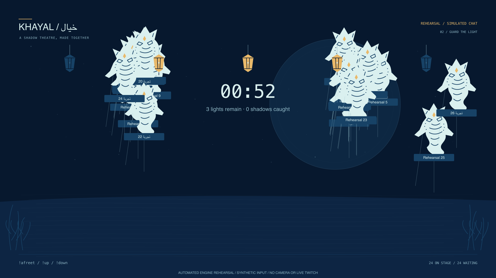

# Agent-operated show rehearsal

The owner asked Codex to run the rehearsal without their performance. `npm run rehearse` executes the real command parser, Director, mask processor and shared SVG scene locally with deterministic synthetic viewers, a seeded random generator and60Hz virtual time. No account access, camera, browser automation or OBS is used. The browser bridge was unavailable during this run.

[Machine-readable result](report.json):23checks passed across209commands and12,832director steps, covering213.84virtual show seconds plus a separate30virtual-second stationary-mask fixture. This is an accelerated source-level rehearsal, not a real-time performance or new gameplay recording. It supplements the existing actual Twitch/camera footage.

- Fifty simulated viewers enter24active/26waiting; every viewer gets a turn.
- Movement cooldown, depth/jump, mixed Arabic/English caption sanitation and queued-caption deletion work through the normal parser.
- A viewer cannot issue a moderator pause; an authorized synthetic moderator can pause/resume the Hunt clock.
- Two complete countdown/Hunt sequences resolve in opposite outcomes: the undefended round loses all five lights; changing synthetic mask boundaries produce a keeper win with five lights.
- Constant synthetic masks emit no new motion; expired mask data cannot hit. These results are not a physical-swat study.
- Ordinary actors park and ceremonies remain hidden during Hunt. Simulated follow/raid ceremonies resume afterward, with the caravan capped at eight camels.
- Curtain clears actors while retaining all50synthetic cast entries. Actual PNG playbill downloads were verified separately in the [clean-release record](../../clean-release-validation.json).

The report identifies the source revision, runner hash, virtual time, assertions and artifact hashes. Unit tests remain a separate64-test suite. No simulated participant/event is called a real viewer/follow/raid. Human fairness, physical motion accuracy, real provider events and OBS recording remain unverified; the owner does not need to perform this automated rehearsal.

| Source-level frame | Purpose |
|---|---|
|[Free play](01-freeplay.png)|Crowded cast and mixed-language caption.|
|[Undefended Hunt](02-hunt-no-defense.png)|Active spirits and lantern losses.|
|[Simulated caravan](03-simulated-caravan.png)|Deferred raid ceremony.|
|[Synthetic defense](04-synthetic-mask-defense.png)|Artificial mask fixture, no camera silhouette.|
|[Keeper result](05-keeper-result.png)|Round completed through ordinary game ticks.|
|[Curtain](06-curtain.png)|Cast retained for credits.|

These images are rendered shared-scene engine exports, visibly watermarked as synthetic. They are not browser screenshots and have not been added to the actual-gameplay Devpost gallery or substituted into the public demo.
